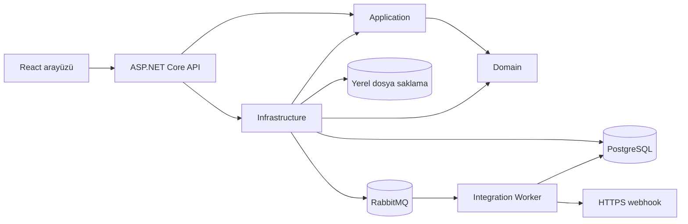

# DocumentFlow

DocumentFlow, kurumsal belgeleri güvenli biçimde yönetmek ve onay süreçlerini izlenebilir kılmak için geliştirilmiş bir web uygulamasıdır. Belge versiyonları, yönetici kararları ve imzalar birbirine açık kimliklerle bağlanır; dosya bütünlüğü SHA-256 ile doğrulanır ve önemli işlemler Audit Trail'e kaydedilir. Clean Architecture katmanları iş kurallarını altyapıdan ayırırken Transactional Outbox ve RabbitMQ, belge olaylarını entegrasyonlara güvenilir biçimde taşır.

## Temel özellikler

| Alan | Uygulanan işlevler |
| --- | --- |
| Kimlik ve erişim | JWT authentication; Employee, Manager ve Admin için RBAC; belge sahibi ve atanmış yöneticiye göre sunucu tarafı erişim kontrolü |
| Belge yönetimi | PDF/DOCX oluşturma, listeleme, indirme; 10 MB dosya sınırı; versiyon geçmişi ve SHA-256 bütünlük kontrolü |
| Onay süreci | Son versiyonu yöneticiye gönderme; onay, gerekçeli ret ve revizyon isteme; süreç geçmişi |
| Denetim | Belge, onay, indirme, imza ve webhook yönetimi işlemleri için Audit Trail; Admin filtreleri ve sayfalama |
| İmza | Onaylanmış versiyona RSA-PSS/SHA-256 uygulama imzası ve doğrulama; RFC 3161 zaman damgası; parolayla yeniden doğrulanan mobil imza **simülasyonu** |
| Entegrasyon | Transactional Outbox, RabbitMQ, ayrı Integration Worker; olay abonelikli HTTPS webhook, HMAC-SHA256, yeniden deneme ve DLQ |
| İşletim | Admin operasyon sayaçları; API ve worker metrikleri; veritabanı sorgularında sayfalama, uygun indeksler ve büyük dosyalarda akış tabanlı işleme |

İmza, nitelikli elektronik imza veya PAdES değildir. Development ortamındaki yerel zaman damgası sağlayıcısı güvenilir harici TSA yerine geçmez. Mobil imza akışı gerçek operatör/SIM entegrasyonu içermez.

## Teknoloji yığını

| Katman | Teknolojiler |
| --- | --- |
| Backend | .NET 8, ASP.NET Core Web API, EF Core 8 |
| Frontend | React 19, TypeScript, Vite, özel CSS, TanStack Query |
| Veritabanı | PostgreSQL 16, Npgsql |
| Mesajlaşma ve entegrasyon | RabbitMQ, .NET Integration Worker, HTTPS webhook |
| Güvenlik ve kriptografi | JWT, RBAC, ASP.NET Core PasswordHasher, SHA-256, RSA-PSS, RFC 3161, HMAC-SHA256 |
| Test ve geliştirme | xUnit, ASP.NET Core integration tests, Docker Compose; izole okuma yükü için k6 senaryosu |

## Sistem mimarisi

`Domain` iş kurallarını ve varlıkları, `Application` servis sözleşmelerini ve DTO'ları, `Infrastructure` EF Core, dosya saklama, kriptografi ve entegrasyon uygulamalarını içerir. `Api` HTTP uçlarını ve servis bileşimini sağlar. Frontend API'ye bağlanır; API'nin Outbox publisher'ı RabbitMQ'ya olay yayınlar, ayrı Integration Worker teslimat işlerini PostgreSQL'de takip ederek webhook çağrılarını yapar.



Katman bağımlılıkları ve tasarım kararları için [mimari belgesine](docs/architecture.md), süreç için [belge iş akışına](docs/document-workflow.md), mesaj teslimatı için [entegrasyon belgesine](docs/integrations.md) bakın.

## Kullanıcı rolleri

| İşlem | Employee | Manager | Admin |
| --- | --- | --- | --- |
| Kendi belgesini oluşturma ve yönetme | Evet | Evet | Evet |
| Belgeyi aktif Manager'a onaya gönderme | Sahibi olduğu belgede | Sahibi olduğu belgede | Sahibi olduğu belgede |
| Atanmış onay talebini karara bağlama | Hayır | Evet | Hayır |
| Onayladığı versiyonu imzalama / mobil simülasyon | Hayır | Evet | Hayır |
| Tüm belge ve onay kayıtlarını görme | Hayır | Hayır | Evet |
| Sistem Audit Trail, webhook ve operasyon sayaçları | Hayır | Hayır | Evet |

## Kurulum ve çalıştırma

**Gereksinimler:** [`global.json`](global.json) ile uyumlu .NET 8 SDK (depo şu anda 8.0.425 ister), Vite paketinin `engines` koşuluna uygun Node.js `^20.19.0` veya `>=22.12.0`, Docker ve Docker Compose v2. Yerel doğrulamada Docker 28.3.2 ve Compose 2.38.2 kullanıldı. Komutlar depo kökünde PowerShell içindir.

```powershell
git clone https://github.com/kelesmerve/DocumentFlow.git
Set-Location DocumentFlow
dotnet --version
node --version
docker compose version
```

Önce Git tarafından dışlanan `.env` dosyasına yerel rastgele değerler yazın. Aşağıdaki komutlar parolaları ekrana basmaz:

```powershell
if (Test-Path .env) { throw '.env zaten mevcut; yerel ayarlarınızı koruyun.' }
$rng = [System.Security.Cryptography.RandomNumberGenerator]::Create()
$rabbitBytes = New-Object byte[] 24
$webhookBytes = New-Object byte[] 32
$jwtBytes = New-Object byte[] 32
$rng.GetBytes($rabbitBytes); $rng.GetBytes($webhookBytes); $rng.GetBytes($jwtBytes); $rng.Dispose()
$rabbitPassword = [BitConverter]::ToString($rabbitBytes).Replace('-', '')
$webhookKey = [Convert]::ToBase64String($webhookBytes)
$jwtKey = [BitConverter]::ToString($jwtBytes).Replace('-', '')
$lines = @('RABBITMQ_USERNAME=documentflow', "RABBITMQ_PASSWORD=$rabbitPassword", "WEBHOOK_ENCRYPTION_KEY=$webhookKey", "JWT_SIGNING_KEY=$jwtKey")
[System.IO.File]::WriteAllLines((Join-Path (Get-Location) '.env'), [string[]]$lines, (New-Object System.Text.UTF8Encoding($false)))
docker compose up -d postgres rabbitmq
docker compose ps
```

Bu kurulum `.env` içine `POSTGRES_PASSWORD` eklemez: Compose'taki PostgreSQL servisi ile worker'ın varsayılan development bağlantısı böylece aynı kalır. Mevcut bir `.env` kullanıyorsanız bu iki bağlantı ayarının eşleştiğini kontrol edin.

API için **ayrı bir PowerShell terminalinde**, aynı depo kökünden çalıştırın. `.env` Docker Compose için otomatik okunur; .NET sürecine değerler ayrıca aktarılır. PostgreSQL bağlantısı Compose yapılandırmasından okunur; parola README'ye kopyalanmaz.

```powershell
Get-Content .env | ForEach-Object { if ($_ -match '^([A-Z_]+)=(.*)$') { [Environment]::SetEnvironmentVariable($Matches[1], $Matches[2], 'Process') } }
$postgresPassword = (docker compose config --format json | ConvertFrom-Json).services.postgres.environment.POSTGRES_PASSWORD
$env:ConnectionStrings__DocumentFlow = "Host=localhost;Port=5433;Database=documentflow;Username=documentflow;Password=$postgresPassword"
$env:Jwt__SigningKey = $env:JWT_SIGNING_KEY
$env:RabbitMq__Password = $env:RABBITMQ_PASSWORD
$env:RabbitMq__Enabled = 'true'
$env:WebhookSecurity__EncryptionKey = $env:WEBHOOK_ENCRYPTION_KEY
$env:Timestamping__ProviderType = 'Local'
$env:ASPNETCORE_ENVIRONMENT = 'Development'
dotnet run --project src/DocumentFlow.Api -- --urls http://localhost:5000
```

Development başlangıcında API EF Core migration'larını uygular ve demo hesapları yalnızca yoklarsa oluşturur. API hazır olduktan sonra depo kökündeki başka bir terminalde worker'ı başlatın; Compose, bağlantı bilgilerini `.env` üzerinden iletir:

```powershell
docker compose up -d --build integration-worker
docker compose ps
```

Frontend için başka bir terminal açın:

```powershell
Set-Location frontend
npm.cmd ci
npm.cmd run dev
```

`npm.cmd`, PowerShell yürütme ilkesi `npm.ps1` dosyasını engellese de çalışır. Arayüz `http://localhost:5173`, API `http://localhost:5000`, Development Swagger `http://localhost:5000/swagger`, RabbitMQ Management UI `http://localhost:15672` adresindedir. Frontend'in `/api` istekleri Vite tarafından yerel API'ye yönlendirilir.

| Development hesabı | Rol |
| --- | --- |
| `employee@documentflow.local` | Employee |
| `manager@documentflow.local` | Manager |
| `admin@documentflow.local` | Admin |

Bu hesaplar yalnızca Development ortamı içindir. Demo parolaları dokümantasyona yazılmamıştır; yerel kaynak kodundaki `DevelopmentUserSeeder` içinde tanımlıdır. Bu hesapları gerçek ortama taşımayın.

## Testler

Testler xUnit ve `WebApplicationFactory` kullanır. Integration testleri her factory için ayrı PostgreSQL veritabanı oluşturur ve test sonunda kaldırır; Development veritabanına test verisi yazmaz. PostgreSQL servisi çalışırken depo kökünde:

```powershell
dotnet test
```

Son doğrulanmış koşuda **46/46 test başarılıydı** (4 unit, 42 integration). Testler kimlik/yetki sınırlarını, belge versiyonlarını, onay ve revizyon geçişlerini, Audit Trail'i, imza ve zaman damgası doğrulamasını, mobil simülasyonu ve entegrasyon güvenliğini kapsar. Yük testi senaryosu ve çalıştırma koşulları [performans notlarında](performance/README.md) bulunur; burada ölçülmemiş gecikme veya throughput sonucu sunulmaz.

## Güvenlik

Parolalar `PasswordHasher` ile saklanır; JWT isteklerinde etkin kullanıcı ve güncel rol denetlenir. Belge erişimi sahiplik, atanmış Manager ve Admin yetkisine göre sunucu tarafında kontrol edilir. SHA-256 dosya bütünlüğünü, RSA-PSS kayıtlı belge versiyonunun uygulama düzeyindeki imzasını doğrular. Audit kayıtları iş işlemleriyle birlikte yazılır. Webhook secret'ları şifrelenmiş saklanır; dış çağrılar HTTPS, hedef adres kontrolü, yönlendirme kısıtı, HMAC-SHA256 ve zaman aşımıyla korunur. Transactional Outbox, iş işlemiyle olay kaydını aynı veritabanı işleminde tutar; RabbitMQ ve webhook teslimatı **at-least-once** yaklaşımındadır.

Ayrıntılar: [güvenlik](docs/security.md), [API](docs/api.md) ve [demo senaryosu](docs/demo.md).
