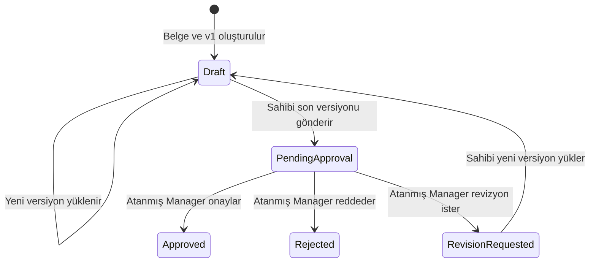

# Belge ve onay iş akışı

Belge oluşturulurken ilk dosya `v1` olarak kaydedilir ve durum `Draft` olur. Her sonraki yükleme yeni bir `DocumentVersion` üretir; eski sürüm ve ona bağlı süreç kayıtları korunur. Yalnızca belge sahibi, `Draft` veya `RevisionRequested` durumunda yeni sürüm yükleyebilir. Her dosya için SHA-256 özeti saklanır; yükleme üst sınırı 10 MB'tır.

## Kurallar

| Geçiş veya işlem | Koşul ve sonuç |
| --- | --- |
| Onaya gönderme | Belge sahibi, `Draft` ve en az bir versiyonu bulunan belge için aktif bir Manager seçer. Talep o anda en son versiyona bağlanır; belge `PendingApproval` olur. Sahip kendisini atayamaz. |
| Karar | Yalnızca talebin atandığı aktif Manager, bekleyen talep için karar verir. Onay `Approved`, ret `Rejected`, revizyon isteği `RevisionRequested` sonucunu üretir. Ret ve revizyonda karar notu zorunludur. |
| Revizyon | Sahip yeni dosya yüklediğinde yeni versiyon oluşur ve belge yeniden `Draft` olur. Önceki `ApprovalRequest` değişmeden kalır; yeniden gönderim ayrı talep açar. |
| Versiyon kilidi | `PendingApproval`, `Approved` veya `Rejected` belgeye bu akışta yeni versiyon yüklenemez. Aynı belgede iki aktif bekleyen talep veritabanı korumasıyla engellenir. |
| İmza | Onaylanmış belirli versiyonu ve ona atanmış onayı bulunan Manager, dosya bütünlüğü doğrulandıktan sonra imzalar. İmza `DocumentSignature` kaydında versiyon kimliğini tutar; belge durumu imza nedeniyle ayrı bir `Signed` geçişine taşınmaz. |

`Signed` ve `Archived` enum değerleri mevcut olsa da bu iş akışında bir geçiş olarak kullanılmaz. Belge detayındaki **Süreç** görünümü belge, versiyon ve onay kayıtlarından oluşturulur; Admin'e açık sistem geneli **Audit Trail** ayrı bir kayıttır.

Doğrudan dijital imza, zaman damgası ve mobil simülasyonun güvenlik kapsamı [güvenlik belgesinde](security.md) açıklanır. İlgili HTTP uçları [API rehberindedir](api.md).
