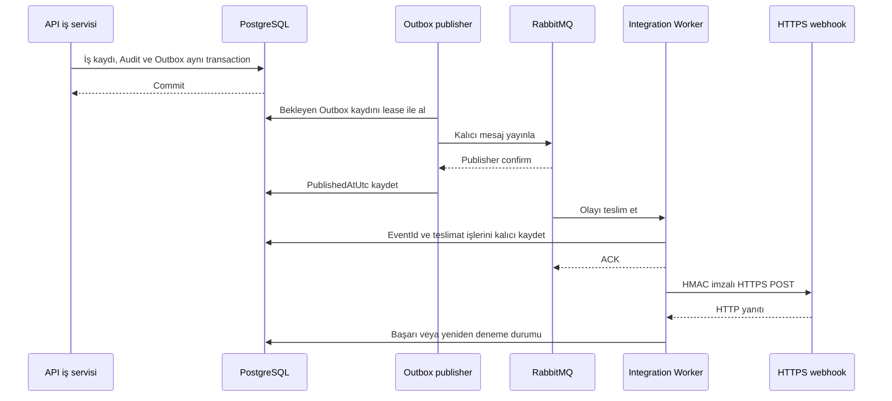

# Entegrasyon ve teslimat akışı

Entegrasyon olayları `DocumentApproved`, `DocumentSigned` ve `MobileSignatureCompleted` türlerindedir. Olay gövdesi kimlikleri, zaman ve şema sürümünü içerir; belge içeriği, JWT, parola, özel anahtar veya webhook secret'ı taşımaz.

## Transactional Outbox

Onaylama veya imzalama sırasında iş kaydı, Audit ve `OutboxMessage` aynı PostgreSQL transaction'ında yazılır. Outbox kaydı `EventId`, `EventType`, `AggregateId`, `OccurredAtUtc`, `SchemaVersion` ve `Payload` tutar. RabbitMQ geçici olarak erişilemezse iş kararı korunur; olay bekleyen Outbox kaydından daha sonra yayınlanır.

API'deki `OutboxPublisherService`, bekleyen kayıtları batch halinde işler. PostgreSQL `FOR UPDATE SKIP LOCKED` ve süreli lease, birden fazla yayıncının aynı kaydı aynı anda seçmesini sınırlar. Mesaj kalıcı RabbitMQ exchange/queue yapısına publisher confirm ile gönderilir; ancak confirm sonrasında yayımlandı olarak işaretlenir. Hatalarda deneme sayısı, hata türü ve üstel geri çekilme zamanı saklanır. RabbitMQ bağlantısı yeniden kurulabilir.

## Tüketim ve webhook işleri

Integration Worker, RabbitMQ mesajından `EventId`, tür ve şema sürümünü doğrular. Tüketilen olay kimliğini ve o sırada aktif, ilgili olaya abone webhook'lar için teslimat işlerini PostgreSQL transaction'ında sakladıktan sonra mesajı ACK eder. Aynı olay tekrar gelirse `EventId` üzerinden ikinci iş kümesi oluşturulmaz.

Worker teslimat işlerini ayrı döngüde işler. Webhook'a `X-DocumentFlow-Event-Id`, `X-DocumentFlow-Event-Type` ve gövde üzerinden hesaplanan `X-DocumentFlow-Signature: sha256=...` başlıklarıyla HTTPS POST gönderir. Hedef güvenliği, gizli anahtar saklama ve HMAC kapsamı [güvenlik belgesindedir](security.md).

Başarısız teslimatlar yapılandırılabilir üst deneme sayısına kadar üstel geri çekilmeyle yeniden denenir; sonrasında DLQ yayını ve kalıcı hata durumu takip edilir. Geçersiz RabbitMQ olayları da yeniden sıraya alınmadan DLQ'ya yönlendirilir. Admin, `/api/integrations/webhooks/deliveries` üzerinden son teslimatların durumunu ve hata türünü görebilir.

Bu yapı **at-least-once** teslimat sağlar. Publisher confirm, ACK veya HTTP yanıtı sonrasında bağlantı kesilmesi gibi durumlarda aynı olay yeniden görülebilir. `EventId` tüketim tarafındaki yinelenen iş oluşturmayı önler; webhook alıcısı da `EventId` ile tekrarları idempotent işlemelidir. **Exactly-once teslimat garantisi yoktur.**
